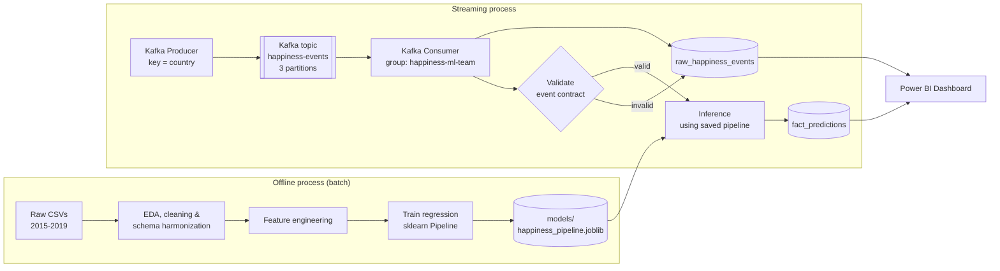
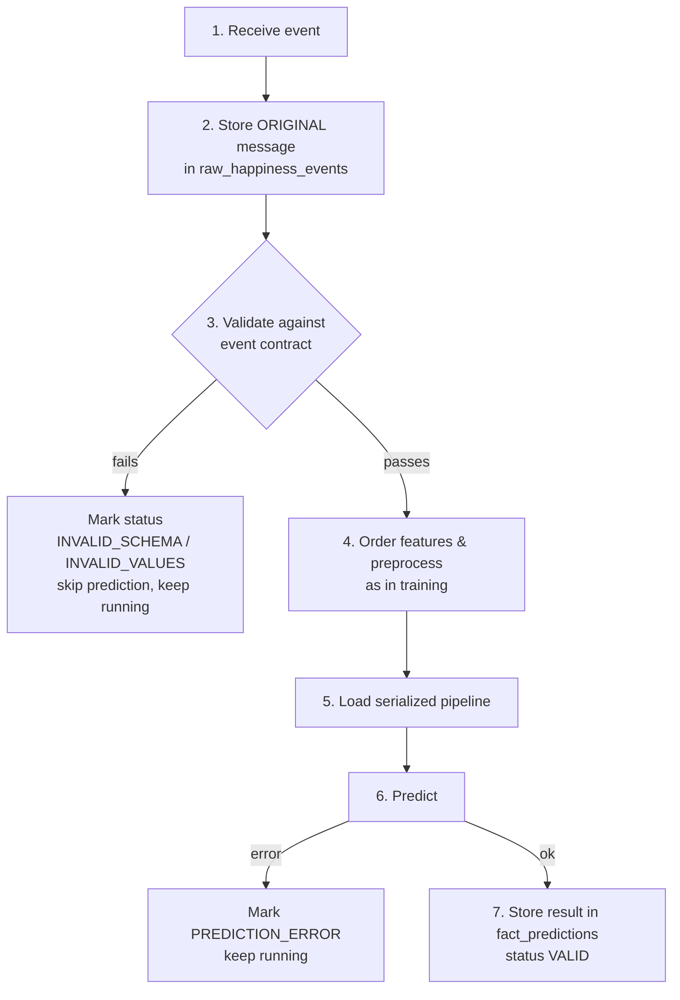
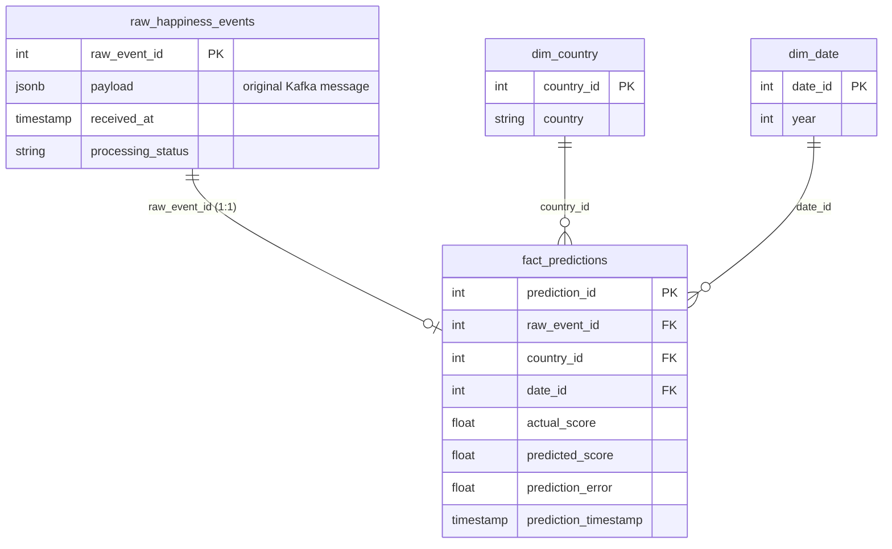

# 🌍 World Happiness Report: Streaming ETL with Apache Kafka & Machine Learning

> **Course:** ETL (G01) · Data Engineering and Artificial Intelligence · Universidad Autónoma de Occidente
> **Workshop-3:** Streaming ETL with Apache Kafka and Machine Learning
> **Author:** Saith Gurrute


---

## Table of Contents

1. [Project Description](#1-project-description)
2. [Architecture Explanation](#2-architecture-explanation)
3. [Data Profiling](#3-data-profiling)
   - [3.1 Overview by year](#31-overview-by-year)
   - [3.2 Profiling per year](#32-profiling-per-year)
   - [3.3 Data quality observations](#33-data-quality-observations)
   - [3.4 Unified schema proposal](#34-unified-schema-proposal)
4. [Data Cleaning Decisions](#4-data-cleaning-decisions)
5. [Feature Engineering Decisions](#5-feature-engineering-decisions)
6. [Machine Learning Pipeline](#6-machine-learning-pipeline)
   - [6.1 Model and evaluation](#61-model-and-evaluation)
   - [6.2 Statistical validation (evidence)](#62-statistical-validation-evidence)
7. [Kafka Pipeline and Event Contract](#7-kafka-pipeline-and-event-contract)
8. [Database Schema](#8-database-schema)
9. [Dashboard Explanation](#9-dashboard-explanation)
10. [Execution Instructions](#10-execution-instructions)
11. [Repository Structure](#11-repository-structure)
12. [Design Decisions & Limitations](#12-design-decisions--limitations)

---

## 1. Project Description

This project implements an end-to-end **data engineering and machine learning pipeline** over the **World Happiness Report (2015–2019)**. It covers the full transition from **batch ETL** to an **event-driven streaming architecture**:

- **Offline (batch):** profile, clean and harmonize five yearly CSV files with different schemas into one analytical dataset, then train and serialize a regression model.
- **Online (streaming):** a Kafka producer replays the historical records one by one as simulated real-time events; a Kafka consumer stores each raw event, validates it against an event contract, runs real-time inference with the serialized model and stores the results in PostgreSQL.
- **Analytics:** a Power BI dashboard queries the database (never CSV files) to monitor model quality and explain the factors behind happiness scores.

> 🎯 As the workshop states, the goal is **not** to maximize ML accuracy, but to build a **reliable, reproducible and consistent streaming pipeline**. For that reason a simple Multiple Linear Regression is used.

---

## 2. Architecture Explanation

The solution is containerized (Docker Compose) and event-driven. Kafka decouples data generation (producer) from the prediction engine (consumer).



**Data flow:**
`Raw CSVs` ➔ `EDA & Cleaning` ➔ `Model Training` ➔ `Kafka Producer` ➔ `Kafka Topic` ➔ `Kafka Consumer` ➔ `Raw storage` ➔ `Validation` ➔ `Inference` ➔ `PostgreSQL` ➔ `Power BI`

| Component | Location | Responsibility |
|---|---|---|
| Extraction & storage | `data/raw/`, `data/processed/` | Source CSVs (2015–2019) and the harmonized master dataset |
| Exploration & profiling | `notebooks/eda.ipynb` | Data quality analysis, statistical validation, visualizations |
| ETL & ML logic | `src/extract.py`, `src/transform.py`, `src/train.py` | Harmonization, master dataset generation and model training |
| Streaming | `src/producer.py`, `src/consumer.py` | Event publishing, validation, inference and loading |
| Infrastructure | `docker-compose.yml` | Apache Kafka, Zookeeper and PostgreSQL |
| ML artifact | `models/happiness_pipeline.joblib` | Serialized preprocessing + regression pipeline |
| Data modeling | `sql/init_schema.sql` | DDL for the analytical database |
| Visualization | `dashboard/Analisis predictivo.pbix` | Power BI report connected to PostgreSQL |

---

## 3. Data Profiling

Before any transformation, the five yearly files were profiled in `notebooks/eda.ipynb`. The profiling covered every check required by the workshop: **missing values, duplicated records, inconsistent column names, inconsistent data types, schema differences between years and potential outliers.**

### 3.1 Overview by year

| Year | Dimensions (rows × cols) | Nulls | `Region` | Residual / interval variables | Schema state |
|---|---|---|---|---|---|
| 2015 | 158 × 12 | 0 | Yes | Standard Error, Dystopia Residual | Long names, e.g. `Economy (GDP per Capita)` |
| 2016 | 157 × 13 | 0 | Yes | Confidence Intervals, Dystopia Residual | Standard Error replaced by confidence intervals |
| 2017 | 155 × 12 | 0 | **No** | Whiskers, Dystopia Residual | Dotted names, e.g. `Happiness.Score` |
| 2018 | 156 × 9 | **1** (`Perceptions of corruption`) | No | None | Severe column reduction and renaming |
| 2019 | 156 × 9 | 0 | No | None | Schema identical to 2018 |

**Total:** 782 records across the five files (158 + 157 + 155 + 156 + 156).

### 3.2 Profiling per year

<details>
<summary><b>2015</b>: 158 × 12 (baseline year)</summary>

| Variable | Type | Nulls | Range / cardinality | Critical observations |
|---|---|---|---|---|
| Country | str | 0 | One row per country | No duplicated countries |
| Region | str | 0 | Categorical (e.g. Western Europe) | Valid repetitions: countries are grouped by region |
| Happiness Rank | int64 | 0 | 1 to 158 | **Tie:** position 82 shared by Jordan and Montenegro (same score, 5.192) |
| Happiness Score | float64 | 0 | [2.839 – 7.587] | 157 distinct values (one repeated because of the tie) |
| Standard Error | float64 | 0 | n/a | Variability of the score estimate; not present in later years |
| Economy (GDP per Capita) | float64 | 0 | [0.0 – 1.69042] | All values distinct; one exact minimum of 0.0; **strongly correlated with Family** |
| Family | float64 | 0 | [0.0 – 1.40223] | No duplicates; one value of 0.0; strongly correlated with Economy |
| Health (Life Expectancy) | float64 | 0 | [0.0 – 1.02525] | One repeated value (0.92356) in different rows |
| Freedom | float64 | 0 | [0.0 – 0.66973] | No duplicates; one value of 0.0 |
| Trust (Gov Corruption) | float64 | 0 | [0.0 – 0.55191] | One repeated value in different rows; one value of 0.0 |
| Generosity | float64 | 0 | [0.0 – 0.79588] | No duplicates |
| Dystopia Residual | float64 | 0 | [0.32858 – 3.60214] | No duplicates; baseline comparison value |

</details>

<details>
<summary><b>2016</b>: 157 × 13 (one row fewer, one new statistical column)</summary>

| Variable | Type | Nulls | Range / cardinality | Critical observations |
|---|---|---|---|---|
| Country | str | 0 | 157 distinct | Unique identifier per country, same as 2015 |
| Region | str | 0 | Categorical | Regional structure preserved |
| Happiness Rank | int64 | 0 | 1 to 157 | **3 ties:** three pairs of countries share the same position |
| Happiness Score | float64 | 0 | Similar to 2015 | Same 3 repeated values, a direct consequence of the rank ties |
| Lower Confidence Interval | float64 | 0 | [2.732 – 7.460] | **Schema drift:** new column replacing Standard Error; 3 duplicates caused by the ties |
| Upper Confidence Interval | float64 | 0 | [3.078 – 7.669] | **Schema drift:** upper bound; same duplicate pattern |
| GDP, Family, Health, Freedom, Trust, Generosity, Dystopia | float64 | 0 | Consistent | Distributions and types analogous to 2015; no nulls |

</details>

<details>
<summary><b>2017</b>: 155 × 12 (<code>Region</code> disappears)</summary>

| Variable | Type | Nulls | Range / cardinality | Critical observations |
|---|---|---|---|---|
| Country | str | 0 | 155 distinct | Unique identifier, no duplicates |
| Region | n/a | n/a | Absent | **Critical schema drift:** the column is removed entirely |
| Happiness.Rank | int64 | 0 | 1 to 155 | No rank ties (155 distinct values) |
| Happiness.Score | float64 | 0 | Similar to 2015–2016 | **Anomaly:** 4 repeated score values with different ranks (small rank/score mismatch) |
| Whisker.high / Whisker.low | float64 | 0 | Analogous to 2016 | Renamed: functionally replace the Upper / Lower Confidence Interval |
| Column names | str | 0 | Several headers | **Syntax change:** dotted naming convention (`Happiness.Score`, `Economy..GDP.per.Capita.`) |
| GDP, Family, Health, Freedom, Trust, Generosity, Dystopia | float64 | 0 | Consistent | Same numeric types and distributions; no nulls |

</details>

<details>
<summary><b>2018</b>: 156 × 9 (severe column reduction, first null)</summary>

| Variable | Type | Nulls | Cardinality / duplicates | Critical observations |
|---|---|---|---|---|
| Overall rank | int64 | 0 | 156 distinct | Equivalent to Happiness Rank |
| Country or region | str | 0 | 156 distinct | Despite the name, it only contains the country (no region classification) |
| Score | float64 | 0 | 2 repeated values | Equivalent to Happiness Score |
| GDP per capita | float64 | 0 | 9 repeated values | Direct rename of Economy / GDP |
| Social support | float64 | 0 | 10 repeated values (one value of 0.0) | **Conceptual change:** formally replaces `Family` |
| Healthy life expectancy | float64 | 0 | 143 distinct (13 repeated) | Rename of Health / Life Expectancy |
| Freedom to make life choices | float64 | 0 | 136 distinct (20 repeated) | Rename of Freedom |
| Generosity | float64 | 0 | 122 distinct (34 repeated) | Same column, more coinciding decimals |
| Perceptions of corruption | float64 | **1** | 110 distinct (2 zeros) | ⚠️ **First null (NaN) detected in the whole project** |

</details>

<details>
<summary><b>2019</b>: 156 × 9 (same schema as 2018)</summary>

The 2019 file has the same 9 columns, names and types as 2018, with **no null values**. It required no additional renaming beyond the 2018 mapping.

</details>

### 3.3 Data quality observations

| # | Observation | Dimension checked | Handling |
|---|---|---|---|
| 1 | Only **1 null** in the whole project (`Perceptions of corruption`, 2018) | Missing values | Mean imputation (see [4.2](#42-decisions-and-justification)) |
| 2 | No duplicated countries within any year. Repeated `rank` / `score` values correspond to **ties between different countries**, not to duplicated rows | Duplicated records | No rows removed |
| 3 | Column names change across years (long names, dotted names, 2018–2019 renames) | Inconsistent column names | Standardized to snake_case |
| 4 | Numeric metrics are `float64`, rank is `int64`, country is `str` in every year | Inconsistent data types | Types consistent; explicit casting in the pipeline |
| 5 | `Region` exists only in 2015–2016; Standard Error, Confidence Intervals, Whiskers and Dystopia Residual are not present in 2018–2019 | Schema differences | Only columns common to all years are kept |
| 6 | `Family` is formally replaced by `Social support` in 2018–2019 | Schema differences | Treated as the same dimension |
| 7 | Isolated minimum values of `0.0` (2015: GDP, Family, Freedom, Trust; 2018: Social support, 2 zeros in corruption) | Potential outliers | Flagged during the EDA |
| 8 | Strong correlation between GDP and Family in 2015 | Relationships between variables | Relevant for a linear model (possible multicollinearity) |
| 9 | 2017 shows 4 repeated scores with distinct ranks | Rank / score consistency | `rank` is not used as a model feature |

### 3.4 Unified schema proposal

| Column | Type | Description |
|---|---|---|
| `country` | string | Country name |
| `year` | integer | Report year (derived from the file name) |
| `rank` | integer | Happiness rank (reference only, not a feature) |
| `happiness_score` | float | **Target variable** |
| `gdp_per_capita` | float | Economic output per person |
| `social_support` | float | Social support / family |
| `health_life_expectancy` | float | Healthy life expectancy |
| `freedom` | float | Freedom to make life choices |
| `generosity` | float | Generosity |
| `trust_corruption` | float | Perception of corruption / trust in government |

The column-by-column mapping from each yearly schema to this unified schema is in [section 4.1](#41-schema-differences-found).

---

## 4. Data Cleaning Decisions

The five yearly files **do not share the same schema**, so they had to be analyzed and harmonized before being merged. All decisions were documented during the EDA (`notebooks/eda.ipynb`).

### 4.1 Schema differences found

| Harmonized column | 2015 / 2016 | 2017 | 2018 / 2019 |
|---|---|---|---|
| `country` | `Country` | `Country` | `Country or region` |
| `rank` | `Happiness Rank` | `Happiness.Rank` | `Overall rank` |
| `happiness_score` | `Happiness Score` | `Happiness.Score` | `Score` |
| `gdp_per_capita` | `Economy (GDP per Capita)` | `Economy..GDP.per.Capita.` | `GDP per capita` |
| `social_support` (`family`) | `Family` | `Family` | `Social support` |
| `health_life_expectancy` | `Health (Life Expectancy)` | `Health..Life.Expectancy.` | `Healthy life expectancy` |
| `freedom` | `Freedom` | `Freedom` | `Freedom to make life choices` |
| `generosity` | `Generosity` | `Generosity` | `Generosity` |
| `trust_corruption` | `Trust (Government Corruption)` | `Trust..Government.Corruption.` | `Perceptions of corruption` |
| `year` | *(added from the file name)* | *(added)* | *(added)* |

### 4.2 Decisions and justification

| # | Decision | Justification |
|---|---|---|
| 1 | **`Region` column dropped** | It exists only in 2015 and 2016. Keeping it would introduce a large share of nulls in 2017–2019 and add no value for the model. This is a deliberate *dimensional loss*. |
| 2 | **Residual / interval columns dropped** (`Standard Error`, `Lower/Upper Confidence Interval`, `Whisker.high/low`, `Dystopia Residual`) | They are not present in all years (absent in 2018–2019), so they cannot belong to the unified schema. |
| 3 | **Column names standardized** (snake_case, one name per concept) | Required to merge five files that name the same metric in different ways. |
| 4 | **Data types standardized** | Numeric metrics cast to `float`, `year` to `int`, `country` to `string`, so every year is type-compatible with the event contract. |
| 5 | **`year` column added** | The source files do not contain the year; it is derived from the file name and is needed to trace each observation historically. |
| 6 | **Null handling: mean imputation** | The data proved remarkably clean: only **1 null** across all years (*Perceptions of corruption*, 2018). With a single value, mean imputation preserves the row without distorting the distribution. |
| 7 | **Core column intersection** | The schema was restricted to the columns present in **all** five datasets (see table above), guaranteeing a consistent unified schema. |
| 8 | **Merge into a master dataset** | Output: `data/processed/happiness_master_processed.csv`, the single source for training and for the producer. |

---

## 5. Feature Engineering Decisions

**Target variable:** `happiness_score`

**Selected features (6):**

| Feature | Meaning |
|---|---|
| `gdp_per_capita` | Economic output per person |
| `social_support` | Social support / family (named `family` in the event contract) |
| `health_life_expectancy` | Healthy life expectancy |
| `freedom` | Freedom to make life choices |
| `generosity` | Generosity |
| `trust_corruption` | Perception of corruption / trust in government |

**Features intentionally excluded:**

| Excluded | Reason |
|---|---|
| `rank` | **Target leakage**: the rank is derived directly from the happiness score. |
| `actual_happiness_score` (streaming) | Used **only for evaluation**; it must never be a model input. |
| `country` | Identifier, high cardinality; it is kept as the Kafka key and in the dimension table, not as a predictor. |
| `year` | Time index used for traceability and analytics, not as a predictor. |

**Justification:** the selected variables are the six explanatory factors defined by the World Happiness Report methodology. Their relationship with the score was explored with descriptive statistics and scatter plots in the EDA. Feature **order is fixed** and shared between training and inference to guarantee that the consumer applies *exactly* the same preprocessing as in training.

---

## 6. Machine Learning Pipeline

- **Algorithm:** Multiple Linear Regression (simple model, as required by the workshop).
- **Artifact:** a **scikit-learn `Pipeline`** (preprocessing + model) serialized to `models/happiness_pipeline.joblib`. Bundling both guarantees reproducibility and removes training/serving skew.
- **Training script:** `src/train.py` (reads `data/processed/happiness_master_processed.csv`).

### 6.1 Model and evaluation

| Metric | Value |
|---|---|
| MAE | ≈ 0.43 |
| RMSE | 0.54 |
| R² | 0.77 |

### 6.2 Statistical validation (evidence)

Before deploying the model, the main assumptions of linear regression were validated. All evidence is stored in `notebooks/evidencias/`.

**Linearity**: scatter plots of each explanatory variable against the happiness score.
<br>

<br><br>

**Model fit**: regression fit.
<br>

<br><br>

**Normality of errors**: Q-Q plot and histogram of the residuals.
<br>

<br><br>

**Homoscedasticity**: constant variance of the residuals.
<br>

<br><br>

**Independence of errors**: correlation of the residuals.
<br>


---

## 7. Kafka Pipeline and Event Contract

### 7.1 Topic and producer

| Setting | Value |
|---|---|
| Topic | `happiness-events` |
| Partitions | **3** |
| Replication factor | **1** (local single-broker environment) |
| Event key | `country` (events of the same country go to the same partition) |
| Serialization | JSON |
| Arrival simulation | Configurable delay between records |
| Consumer group | `happiness-ml-team` |

The producer (`src/producer.py`) reads the prepared historical dataset **record by record** and publishes each record as an event, simulating data arriving over time.

### 7.2 Event format

```json
{
  "event_id": "E001",
  "country": "Switzerland",
  "year": 2015,
  "gdp": 1.39651,
  "family": 1.34951,
  "health": 0.94143,
  "freedom": 0.66557,
  "generosity": 0.29678,
  "corruption": 0.41978,
  "actual_happiness_score": 7.587,
  "event_time": "2026-11-09T15:30:00"
}
```

### 7.3 Event contract

> Kafka only transports the record; **the application is responsible for interpreting and validating the business fields.**

| Field | Type | Rule |
|---|---|---|
| `event_id` | string | Non-empty; unique identifier for traceability |
| `country` | string | Non-empty; also used as the Kafka key |
| `year` | integer | Year of the historical observation |
| `gdp`, `family`, `health`, `freedom`, `generosity`, `corruption` | numeric | Compatible with the unified training schema |
| `actual_happiness_score` | numeric | Used **only for evaluation**; never a model input |
| `event_time` | string | Valid ISO-8601 timestamp of when the producer emitted the event |

### 7.4 Consumer flow



**Processing statuses** stored in the raw table:

| Status | Meaning |
|---|---|
| `VALID` | Event passed validation and a prediction was generated |
| `INVALID_SCHEMA` | Missing fields, missing model features or wrong data types |
| `INVALID_VALUES` | Fields present with the right type but invalid numerical values |
| `PREDICTION_ERROR` | Event was valid but the prediction step failed |

**Reliability guarantees:** the raw event is persisted *before* any validation or transformation; invalid records are stored, **skipped from prediction and never crash the pipeline**.

---

## 8. Database Schema

The analytical backend runs on **PostgreSQL** (DDL in `sql/init_schema.sql`).



| Table | Type | Purpose |
|---|---|---|
| `raw_happiness_events` | Raw / staging | Stores the original JSON payload exactly as received, plus ingestion metadata (`received_at`) and `processing_status`. Used for traceability, auditing and reprocessing. It is **not** a dimension. |
| `fact_predictions` | Fact | `actual_score`, `predicted_score`, `prediction_error`, `prediction_timestamp`, linked to the raw event and to the dimensions. |
| `dim_country` | Dimension | Countries |
| `dim_date` | Dimension | Observation year / date |

**Cardinality:** a strict **1:1** relationship between `raw_happiness_events` and `fact_predictions` through `raw_event_id`. Every prediction can be traced back to the exact event that produced it, and Power BI can unpack the historical `year` from the JSON payload and map it to the prediction.

---

## 9. Dashboard Explanation

The dashboard (`dashboard/Analisis predictivo.pbix`) is built in **Power BI** and **queries PostgreSQL directly** (not CSV files). Power Query parses the JSON payloads natively.

### Required KPIs

| # | KPI | Where it is shown | What it tells us |
|---|---|---|---|
| 1 | **Average prediction error** | Page 1 – KPI card (MAE ≈ 0.43) | Overall quality of the model on streamed events |
| 2 | **Predictions by country** | Page 1 | Volume and behavior of predictions per country |
| 3 | **Predicted vs. actual score** | Page 1 | How close the model gets to the real score |
| 4 | **Prediction trends over time** | Page 1 | Historical reality vs. predictions across years |

### Page 1 – Predictive KPIs & Historical Trends
Monitors model performance and contrasts historical scores against the predicted ones.

### Page 2 – Factor Analysis & Correlation (AI visuals)
Focuses on **why** countries score the way they do, using Power BI's native AI visuals:

- **Decomposition Tree:** hierarchically breaks happiness down by country and underlying metrics (e.g., how *family* and *GDP* drive top scores such as Denmark).
- **Key Influencers:** diagnostic ML that identifies the strongest polarizing variables; `corruption` emerged as the dominant factor pulling countries into the lowest happiness tiers.


---

## 10. Execution Instructions

### Prerequisites

- Python 3.9+
- Docker & Docker Compose
- PostgreSQL client (`psql`) *(or run the SQL script from any client)*
- Power BI Desktop (for the dashboard)

### Step-by-step

**1. Clone the repository and create the environment**

```bash
git clone <repository-url>
cd Workshop-3

python -m venv venv
# Windows (PowerShell):
.\venv\Scripts\activate
# Linux / macOS:
source venv/bin/activate

pip install -r requirements.txt
```

**2. Configure environment variables**

Create a `.env` file in the project root with your PostgreSQL / Kafka settings (use the same values as in `docker-compose.yml`). The `.env` file must **not** be committed to the repository.

**3. Start the infrastructure (Kafka, Zookeeper, PostgreSQL)**

```bash
docker-compose up -d
```

**4. Initialize the database schema**

```bash
psql -h localhost -U <your_user> -d <your_db> -f sql/init_schema.sql
```

**5. Process the data and train the model (offline)**

```bash
python src/transform.py   # harmonizes the 5 CSVs -> data/processed/happiness_master_processed.csv
python src/train.py       # trains and saves models/happiness_pipeline.joblib
```

**6. Run the streaming pipeline**

Open **two terminals** with the virtual environment activated in both.

```bash
# Terminal 1 – consumer (validation + inference + loading). Start it first.
python src/consumer.py
```

```bash
# Terminal 2 – producer (streams the events)
python src/producer.py
```

**7. Visualize the results**

Open `dashboard/Analisis predictivo.pbix` in Power BI Desktop and click **Refresh** to load the newly ingested events and predictions from PostgreSQL.

### Quick verification

```sql
SELECT processing_status, COUNT(*) FROM raw_happiness_events GROUP BY 1;
SELECT COUNT(*) AS predictions, AVG(ABS(prediction_error)) AS mae FROM fact_predictions;
```

### Stopping the environment

```bash
docker-compose down        # add -v to also remove the database volume
```

---

## 11. Repository Structure

```text
Workshop-3/
├── data/
│   ├── raw/                  # 2015.csv ... 2019.csv
│   ├── processed/            # happiness_master_processed.csv
│   └── streaming/
├── notebooks/
│   ├── eda.ipynb             # EDA, data quality, unified schema proposal
│   └── evidencias/           # statistical validation plots
├── src/
│   ├── extract.py            # raw CSV loading
│   ├── transform.py          # cleaning & harmonization
│   ├── train.py              # model training & serialization
│   ├── producer.py           # Kafka producer
│   └── consumer.py           # Kafka consumer + inference + DB loading
├── kafka/                    # Kafka configuration
├── models/
│   └── happiness_pipeline.joblib
├── sql/
│   └── init_schema.sql       # DDL: raw, fact and dimension tables
├── dashboard/
│   └── Analisis predictivo.pbix
├── docker-compose.yml
├── requirements.txt
├── .env                      # local settings (not versioned)
└── README.md
```

---

## 12. Design Decisions & Limitations

- **Simple model by design:** the workshop prioritizes pipeline integration, reliability and data consistency over model complexity.
- **Simulated streaming:** the CSVs are bounded historical sources replayed event by event; `event_time` marks when the producer emitted each event, while `year` identifies the historical observation.
- **Raw-first loading:** storing the untouched event before validation enables auditing, debugging and future reprocessing if validation or prediction rules change.
- **Single-broker environment:** replication factor 1 is appropriate for local development only; production would require several brokers and a higher replication factor.
- **Training/serving consistency:** a single serialized `Pipeline` guarantees the consumer applies the same preprocessing and feature order used in training.

---

*Built for ETL (G01) – Universidad Autónoma de Occidente.*